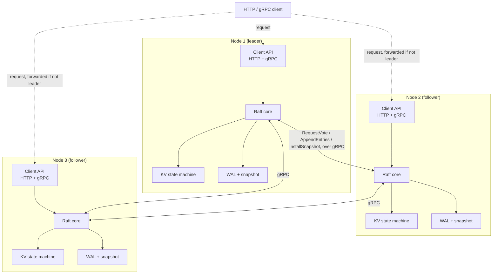
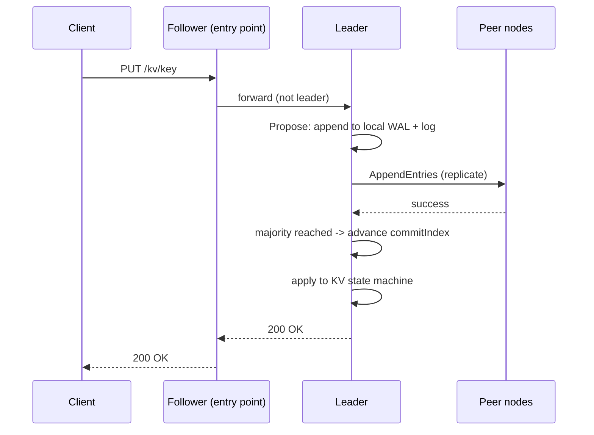

# raft-kv

A distributed key-value store in Go, built around a **Raft consensus implementation written entirely from scratch** — no `hashicorp/raft`, no other consensus library. Leader election, log replication, and snapshotting/log compaction are hand-rolled in [`internal/raft`](internal/raft), on top of a hand-rolled write-ahead log in [`internal/storage`](internal/storage).

This was built as a portfolio project to demonstrate distributed-systems fundamentals: consensus, replication, crash recovery, and testing a system under failure — not just testing that it works when nothing goes wrong.

## Features

- **Raft consensus from scratch**: randomized-timeout leader election, log replication with conflict repair, snapshotting with log compaction, all persisted to disk.
- **Write-ahead log**: append-only, checksummed, crash-safe (a torn write on restart is detected and the clean prefix is kept, nothing more).
- **Client API**: GET / PUT / DELETE over both HTTP and gRPC. Any node can be the entry point — a non-leader node forwards the request to the current leader.
- **3–5 node clusters**, brought up with one `docker compose` command.
- **Fault-injection tests** that kill the leader mid-write, partition the network, and inject latency on a follower — driven through the HTTP API, not just internal unit tests.

## Status

- [x] Project scaffold
- [x] Write-ahead log + KV storage engine
- [x] Leader election
- [x] Log replication
- [x] Snapshots & log compaction
- [x] gRPC transport
- [x] HTTP + gRPC client API
- [x] Fault-injection tests
- [x] Benchmarks
- [x] Docker Compose cluster

## Architecture

Each node runs the same stack. The Raft core persists its log and hard state (current term, vote) through a write-ahead log; once an entry is committed, it's applied to the KV state machine, which is itself what gets snapshotted for log compaction. Inter-node Raft RPCs (`RequestVote`, `AppendEntries`, `InstallSnapshot`) travel over gRPC. The client-facing API (HTTP and gRPC) sits in front of all of that: a request to a non-leader node is forwarded to whichever node is currently leader.



### Write path



## Quick start

### Docker Compose (3-node cluster)

```bash
docker compose -f deploy/docker-compose.yml up --build
```

Then, from the host:

```bash
curl -X PUT -d "world" http://localhost:8001/kv/hello
curl http://localhost:8002/kv/hello   # a different node; forwards to the leader if needed
curl -X DELETE http://localhost:8003/kv/hello
```

Kill the leader's container (`docker stop raftkv-node1`, say) and the remaining two nodes elect a new one within a few hundred milliseconds — writes keep working against whichever node you talk to.

### Running locally without Docker

```bash
go build -o bin/raftkv ./cmd/raftkv

./bin/raftkv -id node1 -data-dir data/node1 -raft-addr 127.0.0.1:7001 -http-addr 127.0.0.1:8001 \
  -peers "node2=127.0.0.1:7002=127.0.0.1:8002,node3=127.0.0.1:7003=127.0.0.1:8003" &

./bin/raftkv -id node2 -data-dir data/node2 -raft-addr 127.0.0.1:7002 -http-addr 127.0.0.1:8002 \
  -peers "node1=127.0.0.1:7001=127.0.0.1:8001,node3=127.0.0.1:7003=127.0.0.1:8003" &

./bin/raftkv -id node3 -data-dir data/node3 -raft-addr 127.0.0.1:7003 -http-addr 127.0.0.1:8003 \
  -peers "node1=127.0.0.1:7001=127.0.0.1:8001,node2=127.0.0.1:7002=127.0.0.1:8002" &
```

### HTTP API

| Method | Path        | Body         | Response                      |
|--------|-------------|--------------|--------------------------------|
| GET    | `/kv/{key}` | -            | `200` + value, or `404`        |
| PUT    | `/kv/{key}` | the value    | `200` once committed           |
| DELETE | `/kv/{key}` | -            | `200` once committed           |

### gRPC API

The same GET/PUT/DELETE surface is exposed as the `kv.KV` service (see [`proto/kv.proto`](proto/kv.proto)), on the same port as `-raft-addr` — one gRPC server hosts both the client-facing KV service and the inter-node Raft transport.

## Project layout

```
cmd/raftkv/          main binary: starts a node
internal/
  raft/              Raft core: election, replication, snapshotting (hand-written)
  raft/rafttest/      in-memory, fault-injectable Transport used by raft's own tests
  storage/           write-ahead log, hard-state persistence, KV state machine
  transport/         gRPC transport wiring internal/raft onto the network
  api/               client-facing HTTP + gRPC API, leader forwarding
proto/               .proto sources for both gRPC services
test/
  chaos/             system-level fault-injection tests (kill leader, partitions, slow node)
  bench/             throughput/latency benchmarks against a real cluster
deploy/              docker-compose.yml
```

## Testing

```bash
make test       # go test ./...
make testrace   # go test -race ./...
make bench      # throughput/latency benchmarks (see below)
```

The test suite spans three levels: unit tests in `internal/storage` and `internal/raft` (WAL crash-recovery, election/replication/snapshot correctness, using an in-memory fault-injectable network), a real-gRPC integration test in `internal/transport`, and system-level fault-injection tests in `test/chaos` that drive the cluster through its HTTP API while killing the leader, partitioning the network, and slowing down a follower.

## Benchmarks

PUT throughput and latency against a real cluster — real gRPC between nodes, real HTTP for the client API, all on loopback TCP on a single machine (AMD Ryzen 5 8400F, Windows), 8 concurrent clients, 64-byte values, 1000 operations per run:

| Cluster size | Throughput | p50 latency | p99 latency |
|---|---|---|---|
| 3 nodes | ~720 ops/s | ~11.1 ms | ~16.3 ms |
| 5 nodes | ~520 ops/s | ~15.3 ms | ~21.4 ms |

Reproduce with `make bench` (see [`test/bench`](test/bench)). These numbers are from a single machine with no real network latency between "nodes" and a WAL fsync on every write — they say more about the relative overhead of consensus and durability (5 nodes is slower than 3, mostly because the leader waits on more followers and each one `fsync`s its own WAL) than about an absolute ceiling; a tuned deployment across real machines with batched/pipelined replication would look different in both directions.

## Trade-offs and limitations

Decisions made to keep a hand-rolled Raft implementation tractable, each with a real cost:

- **No read-index / lease-based linearizable reads.** Every request — reads included — is forwarded to and served by the leader, which gives read-your-writes consistency without a separate read protocol. It is *not* full linearizability: the leader answers a read from its local state without first confirming (via a round of AppendEntries) that it's still actually the leader. A real linearizability bug is possible in the narrow window right after a leader is partitioned away but before it's noticed.
- **No fast conflict-backtracking on log mismatch.** A follower whose log diverges from the leader's gets repaired one entry at a time (`nextIndex--` per failed `AppendEntries`), not via the term-based fast-backtrack optimization from the Raft paper's extended guidance. Correct, just slower to converge for long divergences — this is also why snapshotting exists, to bound how long a divergence can even get.
- **No log pipelining or batching.** Every proposed entry does its own WAL `fsync` while holding the node's lock, and replication is triggered per-entry rather than batched. Simpler and still correct, but caps throughput well below what a production Raft implementation (etcd's, for instance) achieves.
- **Snapshots transfer in one RPC.** `InstallSnapshot` sends the entire state machine snapshot in a single message rather than streaming it in chunks. Fine for the KV store sizes this project targets; would need chunking for a much larger dataset.
- **Static cluster membership.** Peers are fixed at startup via `-peers`; there's no Raft joint-consensus membership-change protocol to add or remove nodes from a live cluster.
- **No pre-vote extension.** A partitioned node keeps incrementing its term while it can't reach anyone, so when it rejoins, everyone else's term jumps too (handled correctly — no safety issue — but it's unnecessary term churn that the pre-vote extension avoids).
- **No TLS/auth on gRPC.** Inter-node and client gRPC connections are plaintext (`insecure.NewCredentials()`), appropriate for a local/demo deployment, not for running this over an untrusted network.

## License

[MIT](LICENSE)
